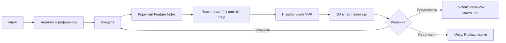

# Game Studio Kit

Переносимый набор для Codex: **идея → исследование и референсы → концепт → Feature Index → короткий MVP → плейтест → развитие или перенос**.

Стартовая фраза: **«я хочу создать игру»**. Первый вопрос: «Какая у тебя идея игры? Коротко опиши, что делает игрок и что в этом должно увлекать». Если идея уже есть в сообщении, вопрос не повторяется. Обсуждение самого набора не запускает игровое интервью.

Это работающий набор инструкций, шаблонов и локальный установщик. Он использует агент и инструменты текущего окружения. Движки, редакторы, генераторы, подписки и MCP не входят в архив. Нет обещания создать любую production-игру одним запросом или автоматически конвертировать Web-код в Unity/Roblox.

## Быстрый старт на другом компьютере

Нужны Codex и Python 3.10+. Получите этот репозиторий через Git или распакуйте релизный ZIP. Команды выполняются **из папки набора**; путь игры должен находиться **вне** этой папки. Git нужен для клонирования, но не для установки из ZIP.

Windows PowerShell:

```powershell
python scripts/kit.py install --project "D:\Games\MyGame" --profile web
```

macOS / Linux:

```bash
python3 scripts/kit.py install --project "$HOME/Games/MyGame" --profile web
```

Откройте `MyGame` в Codex и напишите:

> Используй $game-creator. Я хочу создать игру.

После обнаружения установленного навыка достаточно естественной стартовой фразы. Явный `$game-creator` помогает выбрать правильный вход при наличии старых пересекающихся навыков. Codex обычно замечает изменения автоматически; если навык не появился, откройте новый чат или перезапустите приложение. Формат и обнаружение: [официальная документация](https://learn.chatgpt.com/docs/build-skills).

Установка копирует выбранные папки в `<игра>/.agents/skills/`, без изменения глобальных инструкций или конфигурации. При повторном запуске одинаковые файлы остаются без изменений. При отличиях установка останавливается **до записи** и показывает конфликт. Для осознанного обновления есть `--backup-and-replace`: заменяемые папки сохраняются в `.gamekit-backups` рядом с установленными навыками. Перед использованием этого флага прочитайте различия; резервные копии могут содержать вашу локальную работу.

## Профили

В репозитории **45 скиллов**: 14 новых игровых ролей, 22 Blender, 7 Phaser, Unity и Playwright. Все лежат в одном `skills/`, подключаются по задаче.

| Профиль | Скиллов | Назначение |
|---|---:|---|
| `core` | 5 | Ведущий процесс, рынок/референсы, концепт, MVP, QA |
| `web` | 19 | Рекомендуемый первый путь: HTML/Canvas/Phaser/Three.js, арт, UI, звук, маркетинг, браузерные проверки |
| `art` | 31 | Core, арт/UI/звук/ассеты и все 22 Blender-специализации |
| `unity` | 13 | Core, производственные роли, перенос/mobile и Unity Editor MCP workflow |
| `roblox` | 12 | Core, Luau/Studio, арт/UI/звук/ассеты, маркетинг и перенос |
| `mobile` | 21 | Web + мобильные проверки и перенос |
| `full` | 45 | Вся библиотека, когда нужны все направления |

Профили можно устанавливать последовательно в одну игру: общие идентичные файлы не дублируются. Отсутствующие роли устанавливаются следующим профилем. `full` хранит весь набор локально; агент всё равно читает только нужные инструкции. Большое число навыков может затруднять discovery, поэтому для старта достаточно `web`. Если одинаковые имена уже есть в глобальной коллекции, Codex может показать обе копии: они не сливаются. Набор не удаляет старые навыки; для выбора используйте явный вызов и путь.

## Как идёт работа



Известные ответы не спрашиваются повторно. Платформа прототипа, production-движок, канал распространения, 2D/3D и бизнес-модель — разные решения. По умолчанию предлагается локальный Web MVP; явный выбор пользователя имеет приоритет. Если запрошены только концепт или список фич, процесс заканчивается на них.

Первый MVP проверяет одну главную гипотезу и содержит завершённый цикл с повторным запуском. Фичи получают постоянные F-ID, P0/P1/later и наблюдаемые критерии приёмки. Арт, анимация, UI, звук, Blender, маркетинг и платформенные инструменты включаются, когда они нужны следующему результату.

Референсы и маркетинговые данные сопровождаются ссылками/датой и ограничениями. Набор не придумывает продажи по отзывам и не называет технический smoke test доказательством интереса игроков. Перенос на другую платформу использует концепт, данные, ассеты и сценарии; runtime-код может потребовать новой реализации.

## Документы игры

`game-creator` создаёт и обновляет документы по ходу работы, сохраняя принятую структуру существующей игры. Для пустой папки есть необязательная предварительная команда:

```bash
python scripts/kit.py init --project "PATH_TO_GAME"
```

Она создаёт восемь шаблонов в `docs/game/`: idea, research, concept, feature-index, technical-plan, qa, state.json, asset-register.csv. Это документы, ещё не игра. Существующие файлы сохраняются. `state.json` хранит фазу, принятые решения, неизвестные, активный F-ID, выполненные проверки и следующий шаг. В новом чате сначала восстанавливается это состояние.

## Команды набора

```bash
python scripts/kit.py list --profile web
python scripts/kit.py doctor --project "PATH_TO_GAME"
python scripts/kit.py install --project "PATH_TO_GAME" --profile full --dry-run
python scripts/kit.py validate
python -m unittest discover -s tests -v
python scripts/kit.py package --output "dist/game-studio-kit-0.1.0.zip"
```

В macOS/Linux используйте `python3`, если `python` не настроен. Для установки сразу во все проекты можно явно выбрать пользовательский каталог `--dest "$HOME/.agents/skills"` (PowerShell: `--dest "$env:USERPROFILE\.agents\skills"`). По умолчанию рекомендуется изоляция в папке конкретной игры. Установщик не следует symlink/junction и не выполняет скачанный код. `doctor` проверяет PATH, не все типовые места установки; `NOT_FOUND_ON_PATH` не доказывает отсутствие программы. MCP остаётся UNKNOWN до проверки в живом чате.

## Git и распространение

Исходники готовы для вашего Git-репозитория; удалённый адрес не зашит. После размещения можно дать Codex ссылку и попросить: «Клонируй этот набор, прочитай README, установи профиль web в мою игровую папку; затем используй $game-creator». В наборе есть минимальный `.codex-plugin/plugin.json` для дальнейшей упаковки в плагин. Проверка/публикация в каталоге плагинов здесь не выполнялась; рабочий способ v0.1 — локальная установка из Git/ZIP.

Исходная коллекция из 53 пользовательских скиллов сохранена отдельно. Системные навыки, персональные RobloxGameKit wrapper и материалы с невыясненными условиями не скопированы в public-ready часть. Происхождение и условия: [THIRD_PARTY_NOTICES.md](THIRD_PARTY_NOTICES.md). Версии перечислены в [kit.json](kit.json); исходники не обновляются автоматически.

## Анализ и проверки

- [Аудит всех локальных скиллов](docs/LOCAL_SKILLS_AUDIT.md).
- [Оценка базы dim-s и внешних инструментов](docs/RESEARCH_AND_TOOLS.md).
- [Архитектура и развитие набора](docs/ARCHITECTURE.md).
- [Фактически выполненные проверки и ограничения](docs/VALIDATION.md).

Собственные файлы — MIT. Включённые сторонние навыки сохраняют свои лицензии и copyright. Ссылки на игры и методологии не передают права на их ассеты.
